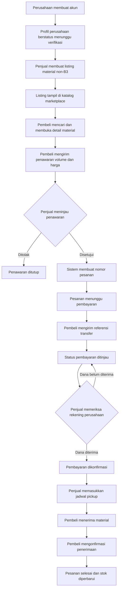

# Desain Sistem T’wwasteful

## 1. Aktor sistem

| Aktor | Hak akses |
|---|---|
| Pengunjung | Membuka landing page dan melihat katalog aktif |
| Pembeli | Mencari material, mengajukan penawaran, mengirim referensi pembayaran, mengonfirmasi material diterima |
| Penjual | Membuat dan mengelola listing, menerima/menolak penawaran, mengonfirmasi pembayaran setelah memeriksa dana, menjadwalkan pengambilan |
| Pembeli + Penjual | Memiliki gabungan hak pembeli dan penjual |
| Administrator | Meninjau dan mengubah status verifikasi perusahaan |

## 2. Alur transaksi utama

## 3. Prinsip pembentukan harga

- Penjual memasukkan harga awal per kilogram (`price_per_kg`).
- Pembeli mengajukan volume dan harga tawaran per kilogram.
- Estimasi nilai pesanan = volume yang disetujui × harga per kilogram yang disetujui.
- Harga akhir adalah harga dari penawaran yang diterima penjual.
- Biaya logistik/pickup belum otomatis dihitung. Kedua perusahaan menyepakatinya langsung dan menuliskannya dalam catatan/jadwal.
- Komisi T’wwasteful belum dipotong otomatis di MVP. Komisi 5–10% dari proposal bisnis dapat ditambahkan setelah model penagihan dan integrasi pembayaran ditetapkan.

## 4. Prinsip stok dan pesanan

- Listing aktif dapat menerima penawaran selama stok tersedia.
- Ketika penjual menerima satu penawaran, listing masuk status `reserved` agar penawaran lain tidak diterima untuk stok yang sama pada saat bersamaan.
- Setelah pembeli mengonfirmasi material diterima, stok dikurangi berdasarkan volume pesanan.
- Jika stok tersisa, listing aktif kembali. Jika stok habis, listing menjadi `sold`.
- Jika pesanan dibatalkan sebelum selesai, listing diaktifkan kembali.

## 5. Entitas basis data

- `companies`: profil dan status verifikasi perusahaan.
- `users`: akun, email, password hash, dan peran.
- `listings`: material, spesifikasi, stok, harga, lokasi, foto, status.
- `offers`: penawaran pembeli ke penjual.
- `orders`: hasil kesepakatan penawaran dan tahapan pemenuhan.
- `notifications`: pemberitahuan aktivitas akun perusahaan.

Relasi utama: satu perusahaan memiliki satu atau lebih akun pengguna; satu perusahaan dapat memiliki banyak listing; satu listing dapat memiliki banyak penawaran; satu penawaran yang disetujui menghasilkan satu pesanan.

## 6. Batas MVP dan kebutuhan sebelum peluncuran nyata

MVP ini menangani pencarian, penawaran, pencatatan pesanan, konfirmasi pembayaran, dan koordinasi jadwal pengambilan. MVP belum memproses transfer, menahan dana (escrow), mengirim invoice resmi, memverifikasi dokumen legal otomatis, menghubungkan ekspedisi, atau menangani sengketa secara formal.

Sebelum penggunaan komersial, perlu ditambahkan payment gateway, kontrak/terms transaksi B2B, upload dokumen legal, proses pemeriksaan jenis limbah dan izin, audit log, role dan permission yang lebih granular, backup database, monitoring, serta kebijakan privasi dan retensi data. Tahap awal platform dibatasi ke material non-B3 dan pernyataan pengguna bukan pengganti pemeriksaan legal.
